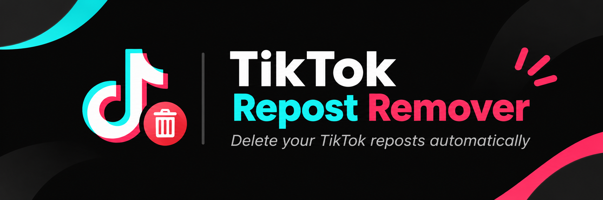

 <p align="center">
  
 </p>

<p align="center">
  
  
  
  
  
</p>

# TikTok Repost Remover

> **Automatically remove TikTok reposts using Python and Selenium.**
>
> A browser automation tool that helps users clean up their TikTok repost history. Remove all reposts or selectively delete them based on caption keywords.

---

## What it does

- **Automated login** — Opens TikTok and assists with account login.
- **Delete all reposts** — Automatically navigates through reposted videos and removes them one by one.
- **Selective deletion** — Finds reposts matching specific caption keywords.
- **Automatic navigation** — Moves between videos without manually opening each one.
- **Debugging support** — Saves screenshots and HTML when the removal button cannot be found.
- **Manual verification** — Allows users to complete CAPTCHA and OTP verification manually.

---

## Backstory

At 00:56 AM, a friend messaged me with a request: build a tool that automatically deletes TikTok reposts.

At first, I didn't take it seriously. I thought it was just a small favor.

But after looking into it, I realized it was a real problem.

TikTok doesn't provide a built-in option to delete all reposts at once. Users have to open each repost individually and remove it manually.

Imagine doing that for thousands of reposts.

My friend had **1,600+ reposts 💀**.

So what started as a small favor turned into an automation project.

<p align="center">
  
</p>

I built this tool by inspecting TikTok's web interface using Chrome DevTools and testing its page elements individually.

Since TikTok doesn't provide public documentation for this particular interface, the implementation relies on browser selectors that may change over time.

---

## How it works

```text
       TikTok Account
              |
              v
        Open Chrome
              |
              v
        Login Process
              |
              v
       Open User Profile
              |
              v
          Repost Tab
              |
              v
       Select Delete Mode
              |
        +-----+-----+
        |           |
        v           v
    Delete All   Delete Specific
        |           |
        v           v
   Remove Repost  Match Keywords
        |           |
        +-----+-----+
              |
              v
       Navigate Videos
              |
              v
       Display Results
```

**Manual Repost Management → Automated Repost Management**

---

## Features

### 1. Delete All Reposts

Automatically processes reposted videos one by one.

The script:

1. Opens the user's repost tab.
2. Opens the first reposted video.
3. Finds the remove-repost button.
4. Removes the repost.
5. Navigates to the next video.
6. Repeats until it reaches the end or encounters an issue.

### 2. Delete Specific Reposts

Remove only reposts matching specific caption keywords.

Example:

```text
Enter keywords: music, gaming, football
```

The script checks available captions and processes matching reposts.

### 3. Automatic Debugging

When the removal button cannot be found, the script saves:

```text
debug_screenshots/
├── gagal_tombol_remove_repost.png
└── gagal_tombol_remove_repost.html
```

These files help identify changes in TikTok's page structure.

---

## Tech Stack

| Technology | Purpose |
|---|---|
| Python | Core programming language |
| Selenium | Browser automation |
| Google Chrome | Browser controlled by Selenium |
| ChromeDriver | Browser automation driver |
| WebDriver Manager | ChromeDriver management |

---

## Installation

### 1. Clone the repository

```bash
git clone https://github.com/givenglorious/tiktok_auto_delete_repost.git
cd tiktok_auto_delete_repost
```

### 2. Install dependencies

```bash
pip install -r requirements.txt
```

### 3. Configure your credentials

Open `tiktok.py` and configure:

```python
USERNAME = "YOUR_TIKTOK_USERNAME"
LOGIN_ID = "YOUR_EMAIL"
PASSWORD = "YOUR_PASSWORD"
```

- `USERNAME` — TikTok profile whose reposts you want to manage.
- `LOGIN_ID` — Email or username used to log in.
- `PASSWORD` — TikTok account password.

> **Security:** Never commit your actual credentials to GitHub. Keep your configured local file private.

### 4. Run the application

```bash
python tiktok.py
```

Make sure Google Chrome is installed on your computer.

---

## Usage

After launching the script, Chrome will open automatically.

Complete the login process. If TikTok requests CAPTCHA or OTP verification, complete it manually in the browser.

Once logged in, the terminal displays:

```text
=== TikTok Repost Remover ===

Pilih mode:

1. Hapus SEMUA postingan ulang
2. Hapus HANYA repost tertentu

Masukkan 1 atau 2:
```

### Mode 1 — Delete All

Select:

```text
1
```

The script automatically processes available reposts.

### Mode 2 — Delete Specific Reposts

Select:

```text
2
```

Enter caption keywords:

```text
Masukkan kata kunci caption:
music, gaming, football
```

Only reposts with matching available caption text will be processed.

---

## Project Structure

```text
tiktok_auto_delete_repost/
│
├── .vscode/
│
├── assets/
│   └── banner.png
│
├── chat_proof.jpeg
│
├── requirements.txt
│
├── tes.py
│
├── tiktok.py
│
└── README.md
```

The `debug_screenshots/` directory is generated automatically when the script encounters a specific debugging condition.

---

## Important Notes

- The delete-all process may not finish in a single run.
- CAPTCHA, OTP verification, rate limits, or network issues may interrupt automation.
- TikTok frequently changes its web interface and element selectors.
- Google, Facebook, and Apple login methods may require manual login.
- Always verify the results after running the script.
- Only use this tool on accounts you own or have explicit permission to manage.

**This is an independent automation project and is not affiliated with, endorsed by, or officially connected to TikTok.**

---

## Limitations

- Depends on TikTok's current web interface.
- CSS selectors and element attributes may become outdated.
- Requires an active internet connection.
- CAPTCHA and OTP cannot be reliably automated.
- Deletion speed depends on network conditions and TikTok's response.
- Keyword matching depends on the available caption text.

---

## License

See [LICENSE](LICENSE) for license information, if included in the repository.

---

<p align="center">
  Built by <a href="https://github.com/givenglorious">Given Glorious</a>
</p>

<p align="center">
  <i>Built to solve a real problem through automation.</i>
</p>
